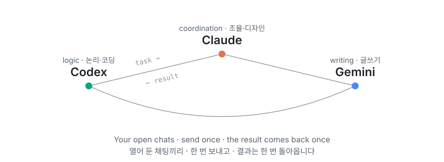

<p align="center">
  
</p>

<div align="center">

# 🔗 local-agent-bridge

**Let the Codex, Claude and Gemini desktop chats you already have open hand work to each other.**<br>
<sub lang="ko">이미 열어 둔 Codex·Claude·Gemini 데스크톱 채팅끼리 서로 일을 주고받게 연결합니다.</sub>


<kbd>[🚀 Install](#-install-설치)</kbd> &nbsp; <kbd>[🤖 AI install](AI_INSTALL.md)</kbd> &nbsp; <kbd>[🧭 How it works](#-how-it-works-작동-방식)</kbd> &nbsp; <kbd>[⚖️ 0BSD](LICENSE)</kbd>

</div>

---

## ✨ What you can do <br><sub lang="ko">할 수 있는 일</sub>

<table>
<tr>
<td width="50%" valign="top">

💬 **Ask one chat, get the team**<br>
Tell one registered chat what you need. It hands logic work to Codex and writing to Gemini, and the results come back to that chat.<br>
<sub lang="ko">등록한 채팅 한 곳에 말하면 논리 작업은 Codex에, 글쓰기는 Gemini에 넘기고, 결과는 그 채팅으로 돌아옵니다.</sub>

</td>
<td width="50%" valign="top">

🧠 **Keep each chat as it is**<br>
It works with the chats you already use, with their history, model and permission mode. No new terminal windows and no copy-pasted prompts.<br>
<sub lang="ko">지금 쓰는 채팅을 대화 기록·모델·권한 모드 그대로 씁니다. 새 터미널 창을 띄우거나 프롬프트를 복사해 붙이지 않습니다.</sub>

</td>
</tr>
<tr>
<td width="50%" valign="top">

🪶 **No idle token burn**<br>
Work goes out once and the result comes back once. No polling, no always-on supervisor and no acknowledgement turns.<br>
<sub lang="ko">일은 한 번 보내고 결과는 한 번 받습니다. 상태를 되풀이해 확인하거나, 늘 지켜보는 AI나, 받았다고 답하는 턴이 없습니다.</sub>

</td>
<td width="50%" valign="top">

🛡️ **Guard rails built in**<br>
A delegated task reserves the files it may write and gets a scope check when its result comes back. App updates raise a warning, and a peer chat's message never counts as your approval.<br>
<sub lang="ko">맡긴 일은 쓸 파일을 미리 예약하고, 결과가 돌아올 때 작업 범위를 검사받습니다. 앱이 업데이트되면 경고하고, 다른 채팅의 메시지는 사용자 승인으로 치지 않습니다.</sub>

</td>
</tr>
</table>

### 🧭 How it works <br><sub lang="ko">작동 방식</sub>

Each app's chat is reached through a local channel the app already has. Every message is a small file under `.bridge` that records delivery and the single result.<br>
<sub lang="ko">각 앱이 이미 가진 로컬 통로로 채팅에 닿습니다. 메시지마다 `.bridge` 아래에 작은 파일이 생기고, 전달과 한 번의 결과가 여기에 기록됩니다.</sub>

| App<br><sub lang="ko">앱</sub> | Reached through<br><sub lang="ko">닿는 통로</sub> | Default role<br><sub lang="ko">기본 역할</sub> |
| --- | --- | --- |
| Codex | Codex app's local tool pipe<br><sub lang="ko">Codex 앱의 로컬 도구 파이프</sub> | Logic, backend, analysis<br><sub lang="ko">논리·백엔드·분석</sub> |
| Claude | Claude Code Desktop's authenticated peer pipe<br><sub lang="ko">Claude Code Desktop의 인증된 세션 간 파이프</sub> | Coordination, review<br><sub lang="ko">조율·감독</sub> |
| Gemini | Antigravity's agent API and language server<br><sub lang="ko">Antigravity의 에이전트 API와 언어 서버</sub> | Writing, revision<br><sub lang="ko">글쓰기·개고</sub> |

With only two apps, the missing app's roles move to the other two.<br>
<sub lang="ko">앱이 두 개뿐이면 없는 앱의 역할이 남은 두 앱으로 옮겨 갑니다.</sub>

<!-- See it in action: add the performance short (Gaettong-a relay + word chain) here after recording,
     as docs/assets/performance.webp and a GitHub attachment MP4. -->

## 🧰 Before you start <br><sub lang="ko">준비물</sub>

- [ ] **Windows x64**<br>
  <sub lang="ko">Windows x64</sub>
- [ ] **At least two of these desktop apps, signed in:** [Codex](https://openai.com/codex/) · [Claude](https://claude.com/download) (Claude Code Desktop) · [Gemini (Antigravity)](https://antigravity.google/download)<br>
  <sub lang="ko">위 데스크톱 앱 중 두 개 이상을 설치하고 로그인해 둡니다.</sub>
- [ ] **Internet access** for the first Setup. It downloads Node.js once, about 36 MB.<br>
  <sub lang="ko">첫 Setup에 인터넷 연결이 필요합니다. Node.js를 한 번만 받으며 약 36 MB입니다.</sub>

You do not need to install Node.js yourself. Setup keeps its own copy in this folder and changes neither PATH nor admin settings.<br>
<sub lang="ko">Node.js는 따로 설치하지 않아도 됩니다. Setup이 이 폴더 안에만 받아 두며, PATH나 관리자 설정을 바꾸지 않습니다.</sub>

## 🚀 Install <br><sub lang="ko">설치</sub>

1. **Extract** the release ZIP into a folder you will keep.<br>
   <sub lang="ko">배포 ZIP을 계속 보관할 폴더에 풉니다.</sub>
2. **Run `Setup.cmd`** and pick the apps to connect. Press <kbd>Enter</kbd> to connect every app it found.<br>
   <sub lang="ko">`Setup.cmd`를 실행하고 연결할 앱을 고릅니다. <kbd>Enter</kbd>를 누르면 찾은 앱을 모두 연결합니다.</sub>
3. **Register a chat in each app.** Open a **new** chat and say **"에이전트 브리지에 이 채팅을 등록해줘"** (register this chat with the agent bridge). Codex and Antigravity run one more command on their own.<br>
   <sub lang="ko">앱마다 **새** 채팅을 열고 **"에이전트 브리지에 이 채팅을 등록해줘"**라고 말합니다. Codex와 Antigravity는 명령을 한 번 더 스스로 실행합니다.</sub>
4. **Test the link.** In any registered chat, say **"브리지 연결 시험해줘"** (test the bridge). Each pair of apps trades one ping.<br>
   <sub lang="ko">등록한 채팅 아무 곳에서 **"브리지 연결 시험해줘"**라고 말합니다. 앱 쌍마다 신호를 한 번씩 주고받습니다.</sub>

> [!TIP]
> **Let your AI install it.** Open this folder in Claude, Codex or Gemini and paste:<br>
> <sub lang="ko">AI에게 설치를 맡기려면 Claude·Codex·Gemini 중 하나에서 이 폴더를 열고 아래 문장을 붙여 넣으세요.</sub>
>
> ```text
> 이 폴더의 AI_INSTALL.md대로 설치해 줘.
> ```

> [!NOTE]
> **The skill shows up only in chats opened after Setup.** Registration reads each chat's permission mode and never changes app settings.<br>
> <sub lang="ko">스킬은 Setup 뒤에 새로 연 채팅부터 보입니다. 등록은 채팅의 권한 모드를 읽기만 하고 앱 설정을 바꾸지 않습니다.</sub>

| Apps you connect<br><sub lang="ko">연결한 앱</sub> | What happens<br><sub lang="ko">동작</sub> |
| :---: | --- |
| 1 | Setup stops without installing. There is nothing to connect.<br><sub lang="ko">Setup이 설치하지 않고 멈춥니다. 이어 줄 상대가 없습니다.</sub> |
| 2 | The missing app's roles move to the other app.<br><sub lang="ko">없는 앱의 역할을 다른 앱이 맡습니다.</sub> |
| 3 | Default roles.<br><sub lang="ko">기본 역할대로 나눕니다.</sub> |

## ⚖️ License <br><sub lang="ko">라이선스</sub>

Released under **[0BSD](LICENSE)**.<br>
<sub lang="ko">**0BSD**로 공개합니다.</sub>

<table>
<tr>
<td width="50%" valign="top">

✅ **Free for any use**<br>
Use it for personal projects, work, or paid products and services.<br>
<sub lang="ko">개인 작업, 회사 업무, 유료 제품과 서비스 어디에든 쓸 수 있습니다.</sub>

</td>
<td width="50%" valign="top">

🆓 **No permission or fee**<br>
Copy, modify, redistribute or sell it without asking or paying.<br>
<sub lang="ko">허락을 구하거나 비용을 내지 않고 복사·수정·재배포·판매할 수 있습니다.</sub>

</td>
</tr>
<tr>
<td width="50%" valign="top">

🙏 **Credit is optional**<br>
A one-line mention is always appreciated, but you never have to.<br>
<sub lang="ko">출처 표시는 선택입니다. 한 줄 남겨 주시면 고맙지만 의무는 아닙니다.</sub>

</td>
<td width="50%" valign="top">

📄 **As is**<br>
We provide it without warranty.<br>
<sub lang="ko">보증 없이 있는 그대로 제공합니다.</sub>

</td>
</tr>
</table>

---

## 📚 Reference <br><sub lang="ko">참고</sub>

<details>
<summary>📟 <b>Commands:</b> what each CLI command does<br><sub lang="ko">명령: CLI 명령별 역할</sub></summary>

Run them with the Node.js that Setup placed under `runtime\`, for example `& <node.exe> bin\agent-bridge.mjs status`.<br>
<sub lang="ko">Setup이 `runtime\`에 둔 Node.js로 실행합니다. 예: `& <node.exe> bin\agent-bridge.mjs status`</sub>

| Command<br><sub lang="ko">명령</sub> | What it does<br><sub lang="ko">하는 일</sub> |
| --- | --- |
| `join` | Register the chat it runs in.<br><sub lang="ko">실행한 채팅을 등록합니다.</sub> |
| `selftest` | Send one ping per app pair.<br><sub lang="ko">앱 쌍마다 신호를 한 번 보냅니다.</sub> |
| `send` · `delegate` | Hand a task to another app's chat. `delegate` adds files to write and rules not to break.<br><sub lang="ko">다른 앱 채팅에 일을 맡깁니다. `delegate`는 쓸 파일과 지킬 규칙을 함께 보냅니다.</sub> |
| `claim` · `reply` · `receive` | Take a message once, send the single result, record receipt.<br><sub lang="ko">메시지를 한 번만 맡고, 결과를 한 번 보내고, 받았다고 기록합니다.</sub> |
| `status` · `check` · `inbox` | See where messages stand.<br><sub lang="ko">메시지 상태를 봅니다.</sub> |
| `flush` | Deliver messages queued while an app was closed.<br><sub lang="ko">앱이 꺼져 있던 동안 쌓인 메시지를 보냅니다.</sub> |
| `verify` · `versions` | Check the connection record and installed app versions.<br><sub lang="ko">연결 기록과 설치된 앱 버전을 확인합니다.</sub> |
| `reservations` · `scope-check` | List write reservations and check a result's scope.<br><sub lang="ko">쓰기 예약을 보고, 결과의 작업 범위를 검사합니다.</sub> |

</details>

<details>
<summary>🧩 <b>Library:</b> call the bridge from Node.js<br><sub lang="ko">라이브러리: Node.js에서 직접 쓰기</sub></summary>

```js
import { createBridge } from './src/index.mjs';

const bridge = createBridge({ root: process.cwd() });
const { message } = await bridge.send({ from: 'codex', to: 'gemini', kind: 'ping', body: 'connection check' });
console.log(await bridge.receipts(message.id));
```

`loadRoutingProfile()` and `delegate(bridge, options)` build a task with its write scope and done-when list and send it over the same channel.<br>
<sub lang="ko">`loadRoutingProfile()`과 `delegate(bridge, options)`는 쓸 파일과 완료 기준이 든 지시서를 만들어 같은 통로로 보냅니다.</sub>

</details>

<details>
<summary>🧱 <b>Limits:</b> Windows only, apps must be open<br><sub lang="ko">한계: Windows 전용, 앱이 켜져 있어야 함</sub></summary>

- **Windows x64 only.**<br>
  <sub lang="ko">Windows x64에서만 동작합니다.</sub>
- **Keep the apps open.** If an app is closed, its messages wait in a queue. Open the app and run `flush`.<br>
  <sub lang="ko">앱을 켜 두세요. 꺼져 있으면 메시지가 대기열에 쌓이고, 앱을 켠 뒤 `flush`를 실행하면 보냅니다.</sub>
- **App updates can change the channels.** When a result shows an `app-version-unverified` warning, run `selftest` once and record it with `verify --record-versions true`.<br>
  <sub lang="ko">앱 업데이트로 통로가 바뀔 수 있습니다. 결과에 `app-version-unverified` 경고가 보이면 `selftest`를 한 번 하고 `verify --record-versions true`로 기록합니다.</sub>
- **A Claude chat that holds messages for approval** cannot receive them; the bridge refuses to send rather than leave them waiting.<br>
  <sub lang="ko">메시지를 승인 대기로 붙잡는 Claude 채팅은 받을 수 없습니다. 이때 브리지는 기다리게 두지 않고 보내지 않습니다.</sub>

</details>

<details>
<summary>🛠️ <b>Development</b><br><sub lang="ko">개발</sub></summary>

No dependencies. Run the tests with Node.js 22 or later:<br>
<sub lang="ko">외부 패키지가 없습니다. Node.js 22 이상에서 테스트를 실행합니다.</sub>

```sh
node --test
```

- More: [installer and registration](docs/INSTALLER-20261105.md), [scope and security](docs/SCOPE-SECURITY-20261105.md), [app version guard](docs/APP-VERSION-GUARD-20261105.md), [protocol](docs/PROTOCOL.md).<br>
  <sub lang="ko">더 보기: [설치기와 등록](docs/INSTALLER-20261105.md), [작업 범위와 보안](docs/SCOPE-SECURITY-20261105.md), [앱 버전 감시](docs/APP-VERSION-GUARD-20261105.md), [프로토콜](docs/PROTOCOL.md)</sub>

</details>

<div align="right">

<sub>[↑ Back to top](#-local-agent-bridge)</sub>

</div>
