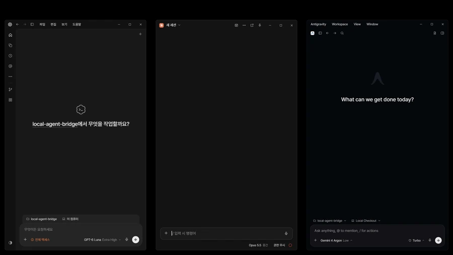

<p align="center">
  
</p>

<div align="center">

# 🔗 local-agent-bridge

**Let the Codex, Claude and Gemini desktop chats you already have open hand work to each other.**<br>
<sub lang="ko">이미 열어 둔 Codex·Claude·Gemini 데스크톱 채팅끼리 서로 일을 주고받게 연결합니다.</sub>


<kbd>[🚀 Install](#-install-설치)</kbd> &nbsp; <kbd>[🤖 AI install](AI_INSTALL.md)</kbd> &nbsp; <kbd>[🧭 How it works](#-how-it-works-작동-방식)</kbd> &nbsp; <kbd>[⚖️ 0BSD](LICENSE)</kbd>

</div>

---

## ✨ What you can do <br><sub lang="ko">할 수 있는 일</sub>

<table>
<tr>
<td width="50%" valign="top">

💬 **Ask one chat, get the team**<br>
Tell one chat what you need and let the other apps share the work. Start with the default role split or assign any task to whichever app you want, and get the finished results right back in that chat.<br>
<sub lang="ko">채팅 한 곳에 할 일을 말하면 다른 앱들과 일을 나누어 처리합니다. 기본 역할 분담으로 바로 시작해도 되고 원하는 앱에 어떤 일이든 직접 맡겨도 되며, 끝난 결과는 말한 채팅으로 돌아옵니다.</sub>

</td>
<td width="50%" valign="top">

🧠 **Keep each chat as it is**<br>
Keep using the chats you already have open, with their history, model and permissions intact. You never have to open extra terminal windows or copy and paste prompts between apps.<br>
<sub lang="ko">지금 열어 둔 채팅의 대화 기록·모델·권한을 그대로 이어서 씁니다. 새 터미널 창을 띄우거나 앱 사이를 오가며 프롬프트를 복사해 붙여 넣지 않아도 됩니다.</sub>

</td>
</tr>
<tr>
<td width="50%" valign="top">

🪶 **No idle token burn**<br>
Save tokens and stop babysitting your chats. You send a task once and get the finished result when it is done, without wasting turns on status checks or "got it" replies.<br>
<sub lang="ko">토큰을 아껴 주고, 끝날 때까지 화면을 지켜볼 필요가 없습니다. 일을 맡기면 끝났을 때 완성된 결과만 돌아오므로 상태 확인이나 수신 응답에 턴을 쓰지 않습니다.</sub>

</td>
<td width="50%" valign="top">

🛡️ **Guard rails built in**<br>
Stay in control while agents collaborate. Two tasks can't claim the same files at once, and each result is checked against the files its task was allowed to change. You get a warning when an app update could affect the connection, and another agent's message never counts as your approval.<br>
<sub lang="ko">여러 AI가 함께 일해도 통제권은 내게 있습니다. 두 작업이 같은 파일을 동시에 맡지 못하게 하고, 결과가 돌아오면 허용한 파일만 고쳤는지 검사해 알려 줍니다. 앱 업데이트로 연결이 달라질 수 있으면 알려 주고, 다른 AI의 요청을 사용자 승인으로 처리하지 않습니다.</sub>

</td>
</tr>
</table>

### 🧭 How it works <br><sub lang="ko">작동 방식</sub>

Your open desktop apps connect directly on your PC without extra API keys or external servers. Every request and result is kept on your PC, so you can always see what was sent and what came back.<br>
<sub lang="ko">열어 둔 데스크톱 앱들이 내 PC 안에서 바로 연결되므로 별도 API 키나 외부 서버가 필요하지 않습니다. 주고받은 일과 결과는 내 PC에 기록되어, 무엇을 맡겼고 무엇이 돌아왔는지 언제든 확인할 수 있습니다.</sub>

| App<br><sub lang="ko">앱</sub> | Default role<br><sub lang="ko">기본 역할</sub> | What you get<br><sub lang="ko">얻는 효과</sub> |
| --- | --- | --- |
| Codex | Logic, backend, analysis<br><sub lang="ko">논리·백엔드·분석</sub> | Handles deep code changes, debugging and verification while you stay in your main chat<br><sub lang="ko">주 채팅을 떠나지 않고도 복잡한 코드 수정·디버깅·검증을 맡겨 결과를 받아 봅니다</sub> |
| Claude | Coordination, review<br><sub lang="ko">조율·감독</sub> | Breaks down your request, delegates tasks to the other apps, and reviews the results in one place<br><sub lang="ko">요청을 나누어 다른 앱에 맡기고 돌아온 결과를 한곳에서 검토해 정리합니다</sub> |
| Gemini | Writing, revision<br><sub lang="ko">글쓰기·개고</sub> | Drafts and polishes docs, UI copy and long text without cluttering your coding chat<br><sub lang="ko">코딩 채팅의 맥락을 어지럽히지 않고 문서 작성·문구 다듬기·긴 글 개고를 처리합니다</sub> |

These default roles are just a starting point—you can hand any task to whichever connected app you prefer. If you connect only two apps, they automatically share all roles between them.<br>
<sub lang="ko">기본 역할은 출발점일 뿐이며, 연결된 어느 앱에든 원하는 일을 자유롭게 맡길 수 있습니다. 앱을 두 개만 연결하면 두 앱이 모든 역할을 알아서 나누어 맡습니다.</sub>

<!-- See it in action: add the performance short (Gaettong-a relay + word chain) here after recording,
     as docs/assets/performance.webp and a GitHub attachment MP4. -->

## 🧰 Before you start <br><sub lang="ko">준비물</sub>

- [ ] **Windows x64**<br>
  <sub lang="ko">Windows x64</sub>
- [ ] **At least two of these desktop apps, signed in:** [Codex](https://openai.com/codex/) · [Claude](https://claude.com/download) (Claude Code Desktop) · [Gemini (Antigravity)](https://antigravity.google/download)<br>
  <sub lang="ko">위 데스크톱 앱 중 두 개 이상을 설치하고 로그인해 둡니다.</sub>
- [ ] **Internet access** for the first Setup. It downloads Node.js once, about 36 MB.<br>
  <sub lang="ko">첫 Setup에 인터넷 연결이 필요합니다. Node.js를 한 번만 받으며 약 36 MB입니다.</sub>

Setup is quick and leaves your system as it is. You do not need to install Node.js yourself: Setup keeps its own copy inside this folder and never touches your PATH or admin settings. The only thing it adds outside this folder is the bridge skill in each app you connect.<br>
<sub lang="ko">설치가 간편하고 PC 환경을 바꾸지 않습니다. Node.js를 따로 설치할 필요가 없으며, Setup이 이 폴더 안에만 받아 두고 PATH나 관리자 설정을 바꾸지 않습니다. 이 폴더 밖에 더하는 것은 연결한 앱마다 들어가는 브리지 스킬뿐입니다.</sub>

## 🚀 Install <br><sub lang="ko">설치</sub>

1. **Extract** the release ZIP into a folder you will keep.<br>
   <sub lang="ko">배포 ZIP을 계속 보관할 폴더에 풉니다.</sub>
2. **Run `Setup.cmd`** and pick the apps to connect. Press <kbd>Enter</kbd> to connect every app it found.<br>
   <sub lang="ko">`Setup.cmd`를 실행하고 연결할 앱을 고릅니다. <kbd>Enter</kbd>를 누르면 찾은 앱을 모두 연결합니다.</sub>
3. **Register a chat in each app.** Open a **new** chat and say **"에이전트 브리지에 이 채팅을 등록해줘"** (register this chat with the agent bridge). Codex and Antigravity run one more command on their own.<br>
   <sub lang="ko">앱마다 **새** 채팅을 열고 **"에이전트 브리지에 이 채팅을 등록해줘"**라고 말합니다. Codex와 Antigravity는 명령을 한 번 더 스스로 실행합니다.</sub>
4. **Test the link.** In any registered chat, say **"브리지 연결 시험해줘"** (test the bridge). It checks that every connected app can talk to the others so you can start right away.<br>
   <sub lang="ko">등록한 채팅 아무 곳에서 **"브리지 연결 시험해줘"**라고 말합니다. 연결된 앱끼리 서로 잘 통하는지 바로 확인해 줍니다.</sub>

> [!TIP]
> **Let your AI install it.** Open this folder in Claude, Codex or Gemini and paste:<br>
> <sub lang="ko">AI에게 설치를 맡기려면 Claude·Codex·Gemini 중 하나에서 이 폴더를 열고 아래 문장을 붙여 넣으세요.</sub>
>
> ```text
> 이 폴더의 AI_INSTALL.md대로 설치해 줘.
> ```

> [!NOTE]
> **The skill shows up only in chats opened after Setup.** Registration safely checks each chat's permission mode without changing your app settings.<br>
> <sub lang="ko">스킬은 Setup 뒤에 새로 연 채팅부터 보입니다. 등록할 때도 각 채팅의 권한 모드만 확인할 뿐 앱 설정은 건드리지 않아 안전합니다.</sub>

| Apps you connect<br><sub lang="ko">연결한 앱</sub> | What happens<br><sub lang="ko">동작</sub> |
| :---: | --- |
| 1 | Setup stops without installing. There is nothing to connect.<br><sub lang="ko">Setup이 설치하지 않고 멈춥니다. 이어 줄 상대가 없습니다.</sub> |
| 2 | The two connected apps share all work between them.<br><sub lang="ko">연결한 두 앱이 모든 작업을 나누어 맡습니다.</sub> |
| 3 | All three apps share the work, starting with default roles you can customize anytime.<br><sub lang="ko">세 앱이 함께 일하며, 기본 역할 분담을 언제든 원하는 대로 바꿀 수 있습니다.</sub> |

## ⚖️ License <br><sub lang="ko">라이선스</sub>

Released under **[0BSD](LICENSE)**.<br>
<sub lang="ko">**0BSD**로 공개합니다.</sub>

<table>
<tr>
<td width="50%" valign="top">

✅ **Free for any use**<br>
Use it for personal projects, work, or paid products and services.<br>
<sub lang="ko">개인 작업, 회사 업무, 유료 제품과 서비스 어디에든 쓸 수 있습니다.</sub>

</td>
<td width="50%" valign="top">

🆓 **No permission or fee**<br>
Copy, modify, redistribute or sell it without asking or paying.<br>
<sub lang="ko">허락을 구하거나 비용을 내지 않고 복사·수정·재배포·판매할 수 있습니다.</sub>

</td>
</tr>
<tr>
<td width="50%" valign="top">

🙏 **Credit is optional**<br>
A one-line mention is always appreciated, but you never have to.<br>
<sub lang="ko">출처 표시는 선택입니다. 한 줄 남겨 주시면 고맙지만 의무는 아닙니다.</sub>

</td>
<td width="50%" valign="top">

📄 **As is**<br>
We provide it without warranty.<br>
<sub lang="ko">보증 없이 있는 그대로 제공합니다.</sub>

</td>
</tr>
</table>

---

## 📚 Reference <br><sub lang="ko">참고</sub>

<details>
<summary>📟 <b>Commands:</b> what each CLI command does<br><sub lang="ko">명령: CLI 명령별 역할</sub></summary>

Run them with the Node.js that Setup placed under `runtime\`, for example `& <node.exe> bin\agent-bridge.mjs status`.<br>
<sub lang="ko">Setup이 `runtime\`에 둔 Node.js로 실행합니다. 예: `& <node.exe> bin\agent-bridge.mjs status`</sub>

| Command<br><sub lang="ko">명령</sub> | What it does<br><sub lang="ko">하는 일</sub> |
| --- | --- |
| `join` | Register the chat it runs in.<br><sub lang="ko">실행한 채팅을 등록합니다.</sub> |
| `selftest` | Send one ping per app pair.<br><sub lang="ko">앱 쌍마다 신호를 한 번 보냅니다.</sub> |
| `send` · `delegate` | Hand a task to another app's chat. `delegate` adds files to write and rules not to break.<br><sub lang="ko">다른 앱 채팅에 일을 맡깁니다. `delegate`는 쓸 파일과 지킬 규칙을 함께 보냅니다.</sub> |
| `claim` · `reply` · `receive` | Claim a task once so the same task isn't worked on twice, send the finished result, and record receipt.<br><sub lang="ko">같은 일을 두 번 하지 않게 한 번만 맡고, 완료 결과를 보내며, 수신을 기록합니다.</sub> |
| `status` · `check` · `inbox` | See where messages stand.<br><sub lang="ko">메시지 상태를 봅니다.</sub> |
| `flush` | Deliver messages queued while an app was closed.<br><sub lang="ko">앱이 꺼져 있던 동안 쌓인 메시지를 보냅니다.</sub> |
| `verify` · `versions` | Check the connection record and installed app versions.<br><sub lang="ko">연결 기록과 설치된 앱 버전을 확인합니다.</sub> |
| `reservations` · `scope-check` | List reserved files and verify that a task only changed allowed files.<br><sub lang="ko">예약된 수정 대상 파일을 확인하고, 허용된 파일만 고쳤는지 검사합니다.</sub> |

</details>

<details>
<summary>🧩 <b>Library:</b> call the bridge from Node.js<br><sub lang="ko">라이브러리: Node.js에서 직접 쓰기</sub></summary>

```js
import { createBridge } from './src/index.mjs';

const bridge = createBridge({ root: process.cwd() });
const { message } = await bridge.send({ from: 'codex', to: 'gemini', kind: 'ping', body: 'connection check' });
console.log(await bridge.receipts(message.id));
```

`loadRoutingProfile()` and `delegate(bridge, options)` let you assign a task with allowed files and completion criteria, so the receiving agent knows its limits and the result can be checked against them.<br>
<sub lang="ko">`loadRoutingProfile()`과 `delegate(bridge, options)`로 수정할 파일 범위와 완료 기준을 함께 보내면, 받는 쪽이 범위를 알고 돌아온 결과도 그 범위로 검사할 수 있습니다.</sub>

</details>

<details>
<summary>🧱 <b>Limits:</b> Windows only, apps must be open<br><sub lang="ko">한계: Windows 전용, 앱이 켜져 있어야 함</sub></summary>

- **Windows x64 only.**<br>
  <sub lang="ko">Windows x64에서만 동작합니다.</sub>
- **Keep the apps open.** If an app is closed, tasks are safely queued instead of lost—just open the app and run `flush` to deliver them.<br>
  <sub lang="ko">앱을 켜 두세요. 앱이 꺼져 있어도 맡긴 일이 사라지지 않고 대기열에 보관되며, 앱을 켠 뒤 `flush`를 실행하면 이어서 전달됩니다.</sub>
- **App updates are checked automatically.** When a result shows an `app-version-unverified` warning after an app update, run `selftest` once and record the new version with `verify --record-versions true`.<br>
  <sub lang="ko">앱이 업데이트되면 연결 호환성을 다시 확인할 수 있게 알려 줍니다. 결과에 `app-version-unverified` 경고가 보이면 `selftest`를 한 번 실행한 뒤 `verify --record-versions true`로 새 버전을 기록합니다.</sub>
- **No silent stalls on approval-locked Claude chats.** If a Claude chat would hold incoming messages for manual approval, the bridge stops right away and tells you instead of leaving your task stuck waiting.<br>
  <sub lang="ko">수동 승인 대기 때문에 작업이 멈춰 있지 않게 막아 줍니다. 메시지를 승인 대기로 붙잡는 Claude 채팅에는 작업을 보낸 뒤 하염없이 기다리게 두지 않고 즉시 알려 줍니다.</sub>

</details>

<details>
<summary>🛠️ <b>Development</b><br><sub lang="ko">개발</sub></summary>

No dependencies. Run the tests with Node.js 22 or later:<br>
<sub lang="ko">외부 패키지가 없습니다. Node.js 22 이상에서 테스트를 실행합니다.</sub>

```sh
node --test
```

- More: [installer and registration](docs/INSTALLER-20261105.md), [scope and security](docs/SCOPE-SECURITY-20261105.md), [app version guard](docs/APP-VERSION-GUARD-20261105.md), [protocol](docs/PROTOCOL.md).<br>
  <sub lang="ko">더 보기: [설치기와 등록](docs/INSTALLER-20261105.md), [작업 범위와 보안](docs/SCOPE-SECURITY-20261105.md), [앱 버전 감시](docs/APP-VERSION-GUARD-20261105.md), [프로토콜](docs/PROTOCOL.md)</sub>

</details>

<div align="right">

<sub>[↑ Back to top](#-local-agent-bridge)</sub>

</div>
